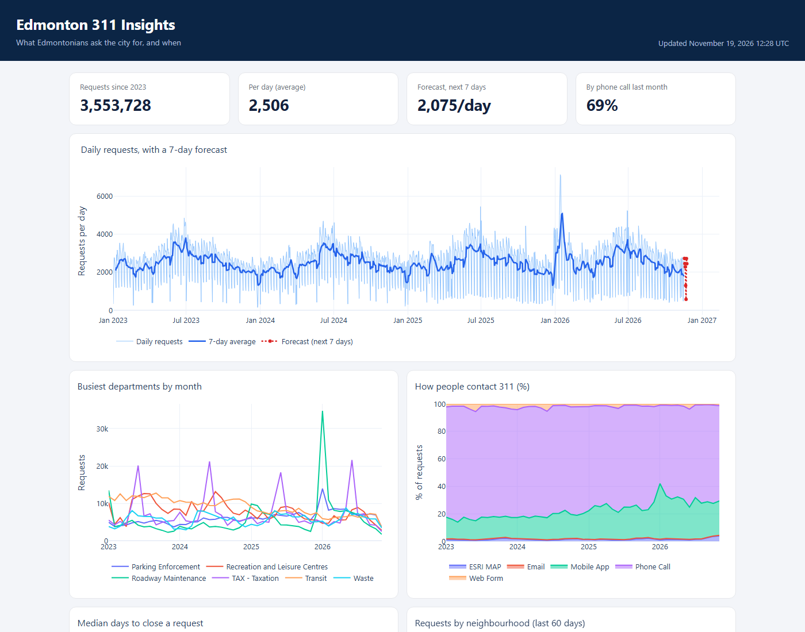

# Edmonton 311 Insights

[](https://github.com/shucab-lane/edmonton-311-insights/actions/workflows/pipeline.yml)

A dashboard of what Edmontonians ask the city for through 311 (potholes, snow plowing, parking, waste), built from **3.5 million** requests on the City of Edmonton's open data portal.

**Live site: https://shucab-lane.github.io/edmonton-311-insights/**



## Features

- Daily request volume since 2023, with a 7-day forecast
- Busiest departments by month and how people contact 311 (phone, app, web)
- How long each department takes to close a request
- Map of requests by neighbourhood
- Refreshes itself with new data every week

## Built with

- **Python**: `requests` pulls data from the city's API, `pandas` cleans it
- **SQL / SQLite**: stores the data; the charts come from SQL queries (GROUP BY, CTEs, window functions)
- **scikit-learn**: predicts next week's request volume (24% more accurate than "same as last week")
- **Plotly**: interactive charts
- **GitHub Actions**: runs the tests and the pipeline every Monday and redeploys the site

## Run it locally

```bash
pip install -r requirements.txt
python -m pipeline          # download data and build site/index.html (2-3 minutes)
pytest                      # run tests
```

## Data

[311 Requests](https://data.edmonton.ca/City-Administration/311-Requests/q7ua-agfg), City of Edmonton Open Data.
